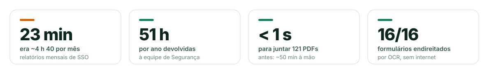

<picture>
  <source media="(prefers-color-scheme: dark)" srcset="assets/banner-dark.svg">
  
</picture>

  
  
  

Trabalho na **Segurança do Trabalho da [Copa Energia](https://www.copaenergia.com.br)**, no Centro Operativo de Cascavel (PR), onde a empresa distribui GLP. Meu foco são problemas reais da rotina: relatórios montados à mão, planilhas que ninguém consegue manter em dia e indicadores que levam horas para fechar. Eu meço quanto tempo a tarefa leva, construo a ferramenta, testo com dados reais e entrego algo que a pessoa usa **sem precisar de mim**.

### Impacto em números

<picture>
  <source media="(prefers-color-scheme: dark)" srcset="assets/impacto-dark.svg">
  
</picture>

## Projeto em destaque

<table>
<tr>
<td width="55%">

</td>
<td>

### [Relatório Mensal SSO](https://github.com/ArthurTureck/relatorio-mensal-sso)

Junta a 1ª página de cada PT, DDS, relato de Quase Acidente e Melhoria do mês, confere a numeração e mostra um **painel que lê as pastas da rede** e se atualiza sozinho.

- Um único **HTML offline**: não precisa instalar nada
- **OCR** endireita formulários escaneados
- Painel em PDF, PNG e Excel para a reunião
- Testes com **Playwright**

`JavaScript` `pdf-lib` `pdf.js` `Tesseract.js` `SVG`

</td>
</tr>
</table>

**Também:** um painel de treinamentos NR em **Python** (pandas e openpyxl) que lê a planilha de pendências e gera um dashboard em Excel com o que está vencido ou perto de vencer.

## Ferramentas

  &nbsp;&nbsp;
  &nbsp;&nbsp;
  &nbsp;&nbsp;
  &nbsp;&nbsp;
  &nbsp;&nbsp;
  &nbsp;&nbsp;
  &nbsp;&nbsp;
  

## Como eu trabalho

| | |
|---|---|
| **1. Medir** | Antes de programar: quanto tempo isso leva hoje e quantas vezes por mês acontece? |
| **2. Construir** | Com dados reais, testando os casos que costumam quebrar: arquivo corrompido, nome fora do padrão, papel escaneado de lado. |
| **3. Entregar** | Algo que a pessoa abre com dois cliques e usa sozinha. |
| **4. Registrar** | O antes e o depois em números. |

Os números acima são de uso real no trabalho. Os projetos públicos usam dados fictícios.
